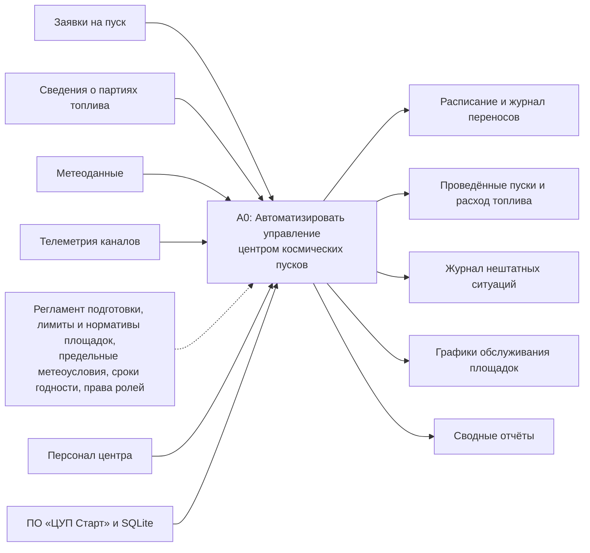

# ЦУП «Старт» — центр управления космическими пусками

Учётная система наземной инфраструктуры космодрома: регистрация пусков ракет-носителей, поэтапная подготовка, учёт топлива по партиям, стартовые площадки и межпусковое обслуживание, метеообеспечение с автоматическим переносом, телеметрический контроль и отчёты руководителя.

Лабораторные работы №3–4 по МДК 03.01 «Моделирование и анализ программного обеспечения»: №3 — прямое проектирование от описания к моделям и коду (ООП + MVC), №4 — адаптация системы к новым требованиям (раздел [«Лабораторная №4»](#лабораторная-4-адаптация-к-новым-требованиям)).

**Стек:** TypeScript, Node.js, Express (Controller), серверные представления на TypeScript (View), SQLite через better-sqlite3 (хранение), TypeDoc (документация кода).

## Запуск

Нужен Node.js 20+.

```bash
npm install
npm run seed     # пересоздать базу data/launch.db с демо-данными
npm start        # http://localhost:3000
```

Другие команды: `npm run dev` — запуск с перезапуском при изменениях, `npm run typecheck` — проверка типов, `npm test` — автотесты, `npm run docs` — документация TypeDoc в `docs/api`, `npm run meteo-mock` — заглушка внешней метеослужбы (лаба №4).

Демо-учётные записи (пароль `start2026`, задаётся переменной `SEED_PASSWORD`):

| Логин | Роль |
|---|---|
| `manager` | Руководитель центра |
| `engineer` | Инженер технического комплекса |
| `telemetry` | Оператор телеметрии |
| `meteo` | Метеоролог |

## Исходные требования

Вариант 3 — «Центр управления космическими пусками (наземная инфраструктура космодрома)».

### Сущности

- **Тип носителя** — наименование и предельные метеоусловия: ветер у земли, ветер на высотах, диапазон температур, облачность.
- **Пуск** — тип носителя, полезная нагрузка, целевая орбита (НОО, ССО, СКО, ГПО, ВЭО), стартовое окно (начало и конец), стартовая площадка, статус, фактическое время старта, наработка агрегатов площадки за пуск.
- **Этап подготовки** — пуск, номер этапа (1–4), время завершения, исполнитель.
- **Партия топлива** — номер, компонент, вид (горючее / окислитель), объём, дата поступления, срок годности.
- **Расход топлива** — пуск, партия, количество, время, исполнитель.
- **Стартовая площадка** — наименование, лимит одновременных подготовок, нормативы моточасов и циклов до обслуживания.
- **Межпусковое обслуживание** — площадка, вид (осмотр, ремонт, замена агрегатов), плановая дата, отметка о выполнении.
- **Канал телеметрии** — код, система носителя, параметр, частота опроса.
- **Нештатная ситуация** — пуск, канал, время потери сигнала, описание, принятые меры.
- **Метеосводка** — пуск, время, ветер у земли и на высотах, температура, облачность, грозовая активность.
- **Перенос** — пуск, прежнее и новое начало окна, категория причины, описание, ссылка на метеосводку.
- **Пользователь** — логин, хеш пароля, ФИО, роль.

### Процессы

1. **Регистрация пуска** руководителем: тип носителя, нагрузка, орбита, площадка, стартовое окно.
2. **Поэтапная подготовка** инженером: (1) доставка и сборка на техническом комплексе → (2) транспортировка на стартовый комплекс → (3) заправка компонентами топлива → (4) предстартовый контроль систем. После четвёртого этапа пуск готов.
3. **Учёт топлива**: поступление партий, списание расхода на пуск на этапе заправки.
4. **Межпусковое обслуживание площадок** по нормативам моточасов и циклов.
5. **Метеообеспечение**: метеоролог вносит сводку; при превышении пределов пуск автоматически переносится на сутки, перенос фиксируется в журнале с причиной.
6. **Проведение пуска** руководителем при готовности и допустимой погоде.
7. **Телеметрический контроль**: оператор фиксирует потерю сигнала по каналу как нештатную ситуацию.
8. **Отчётность** руководителя за период.

### Роли и права

| Действие | Руководитель | Инженер ТК | Оператор телеметрии | Метеоролог |
|---|:-:|:-:|:-:|:-:|
| Просмотр расписания, карточек пусков, топлива, площадок, журнала НС | + | + | + | + |
| Регистрация, перенос и проведение пуска | + | | | |
| Начало подготовки, завершение этапов | | + | | |
| Поступление партий, списание расхода топлива | | + | | |
| Планирование и отметка обслуживания площадок | | + | | |
| Регистрация нештатной ситуации | | | + | |
| Внесение метеосводки | | | | + |
| Отчёты | + | | | |

Права проверяются в слое Model (`actor.require(...)` в каждом сервисе), поэтому их нельзя обойти, минуя интерфейс.

### Правила и ограничения

- Статусы пуска: «Запланирован» → «Подготовка» → «Готов к пуску» → «Пуск проведён». Других переходов нет.
- Стартовое окно начинается в будущем, конец позже начала, длительность не больше 12 ч. Перенос возможен только на более позднее время и только до проведения пуска.
- Этапы подготовки проходятся строго по порядку:
  - транспортировка невозможна, если на площадке уже стоит столько ракет, сколько разрешено одновременных подготовок, или если у площадки выработан норматив моточасов или циклов;
  - заправка не завершается, пока не списаны и горючее, и окислитель.
- Расход топлива фиксируется только на этапе заправки, из непросроченной партии, не больше остатка, больше 0.
- Наработка площадки (моточасы и циклы) считается по пускам после последнего выполненного обслуживания; выполненное обслуживание обнуляет её.
- Метеосводка: ветер 0–80 / 0–150 м/с, температура −70…+60 °C, облачность 0–10 баллов, время не в будущем. Гроза запрещает пуск всегда.
- Пуск проводится только при наличии сводки, которая укладывается в пределы для данного типа носителя.
- Нештатная ситуация регистрируется только у проведённого пуска, не раньше времени старта; описание и принятые меры обязательны.
- Перенос руководителем требует категории (техническая неготовность, неготовность нагрузки, прочее) и описания. Категория «Метеоусловия» ставится только автоматически.

### Отчётность

За выбранный период (по умолчанию текущий год):

1. Пуски по типам носителей: проведено, готовятся, всего, переносов.
2. Расход топлива по партиям: объём, расход за период, число пусков, остаток, срок годности.
3. Загрузка стартовых площадок: пуски за период, ракет на площадке / лимит, моточасы и циклы относительно норматива, обслуживания, состояние.
4. Нештатные ситуации по каналам телеметрии.
5. Переносы пусков по категориям причин с детализацией.

## Модели

Диаграммы (IDEF0, UseCase, диаграммы последовательности, DFD, IDEF1X, диаграммы классов) приведены в отчётах по лабораторным работам №3 и №4 и в репозиторий не входят.

Контекстная диаграмма в Mermaid:



## Архитектура MVC

| Слой | Где в коде | Ответственность |
|---|---|---|
| Model | `src/model/entities` — классы предметной области; `src/model/services` — сценарии и транзакции; `src/model/repositories` — доступ к SQLite; `src/model/reports` — отчёты; `src/db` — схема и демо-данные | бизнес-правила, валидация входных данных с исключениями `DomainError`, проверка прав, переходы статусов, расчёты |
| Controller | `src/controller/*Controller.ts`, `common.ts` | принимает HTTP-запрос, вызывает сервис Model, возвращает страницу или перенаправляет с понятным сообщением об ошибке (шаблон Post/Redirect/Get) |
| View | `src/view/pages/*.ts`, `layout.ts`, `html.ts`, `public/style.css` | формирование HTML: формы, списки, отчёты, сообщения; тегированный шаблон `html` экранирует все значения |

Как слои взаимодействуют:

- View не обращается к базе данных и к сервисам: страница получает от контроллера готовые данные и возвращает строку HTML.
- Controller не содержит бизнес-правил: он передаёт тело формы в метод сервиса, например `launches.completeStage(user, id)`.
- Сервис загружает сущность через репозиторий, вызывает её метод (`launch.completeStage(ctx)`) и сохраняет результат в одной транзакции.
- Ошибка правила (`DomainError`) превращается контроллером в сообщение на странице. Ошибка прав (`AccessDeniedError`) — в страницу 403, отсутствующая запись — в 404.

## Ключевые решения

- **SQLite + better-sqlite3**: синхронный драйвер, транзакции через `db.transaction()`, все запросы параметризованы.
- **Производные величины не хранятся.** Остаток партии = объём − сумма расходов. Наработка площадки = сумма `pad_hours` и количество пусков после последнего обслуживания. Текущий этап = количество записей `launch_stages`.
- **Наследование по смыслу:**
  - `PreparationStage` → 4 этапа: у транспортировки и заправки свои условия завершения;
  - `WeatherCriterion` → 5 критериев погоды;
  - `Report` → 5 отчётов (шаблонный метод `build`);
  - `DomainError` → `AccessDeniedError`, `NotFoundError`.
- **Инкапсуляция:** поля сущностей закрыты, конструкторы приватные. Объект создаётся только фабрикой с проверками (`Launch.register`, `FuelBatch.create`) или восстанавливается из БД (`restore`).
- **Сессии:** токен — 32 случайных байта, в БД хранится только SHA-256. Cookie `httpOnly`, `SameSite=Strict`. Пароли хешируются через scrypt с солью.

## Структура

```
src/
  app.ts                 — сборка приложения и маршрутов
  db/                    — схема SQLite, подключение, демо-данные
  model/
    entities/            — Launch, PreparationStage, FuelBatch, LaunchPad, Weather, Incident, User, …
    services/            — LaunchService, FuelService, WeatherService, TelemetryService, PadService, ReportService, AuthService
    repositories/        — SQL-доступ к таблицам
    reports/             — Report и 5 отчётов
    validation.ts, errors.ts, time.ts
  controller/            — контроллеры Express
  view/                  — страницы и шаблонизатор
public/style.css         — стили
```

## Анализ собственного кода

Результаты аудита (по методике занятия №2) — в отчёте по лабораторной работе. Кратко:

- SQL-инъекций нет: все запросы параметризованы.
- XSS закрыт экранированием в шаблонизаторе.
- Валидация и проверка прав выполняются в Model.
- Найдены и описаны проблемы:
  - нет ограничения попыток входа;
  - демо-учётные записи создаются по умолчанию;
  - нет CSRF-токенов (частично закрыто `SameSite=Strict`);
  - пуск можно провести вне стартового окна;
  - View вызывает методы сущностей;
  - повторяется проверка «пуск существует»;
  - отчёт создаёт репозиторий внутри себя;
  - нет автотестов.

## Лабораторная №4: адаптация к новым требованиям

Выбраны три новых условия варианта 3: роль «Инспектор безопасности» с аудитом действий (условие 3), интеграция с внешней метеорологической службой космодрома (условие 4), учёт топлива с точностью 0,1 кг и блокировка истёкших партий (условие 5). Требования, противоречия, варианты адаптации и доработанные модели описаны в отчёте. **В коде реализовано условие 4.**

### Что делает система

- За 24 ч до начала стартового окна планировщик (`ForecastScheduler`, раз в минуту) запрашивает прогноз погоды по высотам во внешней службе: `GET {METEO_SERVICE_URL}/forecast?pad=…&vehicle=…&at=…`. Запросить прогноз вручную могут метеоролог и руководитель (кнопка в карточке пуска).
- Формат ответа (в требованиях не определён, принят нами): `{ "levels": [{ "altitudeM": 0, "windMs": 6, "temperatureC": 3 }, …], "cloudiness": 4, "thunderstorm": false }`. Профиль сводится к показателям лабы №3: ветер у земли — уровень до 100 м, ветер на высотах — максимум по уровням от 1 км.
- Прогноз сравнивается с теми же пределами типа носителя, что и фактическая сводка (`WeatherAssessment` работает с общим интерфейсом `WeatherReading`). При превышении — **предупреждение о возможном переносе** в карточке и в расписании; окно не меняется, решение о переносе принимает руководитель. Фактическая сводка перед пуском по-прежнему переносит пуск автоматически.
- Таймаут ответа — 10 с (`METEO_TIMEOUT_MS`), через `AbortController`. Таймаут, отсутствие соединения, HTTP-ошибка или ответ не по формату фиксируются как попытка «служба недоступна» с причиной; после этого метеоролог может **ввести прогноз вручную** с обязательным основанием. Ручной ввод проверяется тем же критерием. Повторный автоматический запрос — не чаще раза в 15 минут.
- После переноса окна прогноз запрашивается заново: учитываются только попытки для текущего окна.

### Новые компоненты

| Слой | Файл | Назначение |
|---|---|---|
| Model | `src/model/entities/WeatherForecast.ts` | прогноз (`fromApi`, `manual`), история попыток `ForecastHistory` (когда запрашивать, когда разрешён ручной ввод) |
| Model | `src/model/entities/Weather.ts` | интерфейс `WeatherReading`, критерии работают с ним |
| Model | `src/model/integration/MeteoForecastProvider.ts`, `HttpMeteoForecastProvider.ts` | интерфейс внешней службы, HTTP-реализация с таймаутом, `MeteoServiceError` |
| Model | `src/model/services/ForecastService.ts`, `ForecastScheduler.ts` | сценарии запроса и ручного ввода, планировщик |
| Model | `src/model/repositories/ForecastRepository.ts`, таблица `weather_forecasts` | хранение прогнозов и неудачных попыток |
| Controller | `src/controller/ForecastController.ts`; `action()` в `common.ts` поддерживает async | `POST /launches/:id/forecast`, `POST /launches/:id/forecast/manual` |
| View | `src/view/pages/launch.ts`, `launches.ts` | карточка «Прогноз внешней метеослужбы», предупреждение, форма ручного ввода, метка «риск переноса» в расписании |
| — | `tools/meteo-mock.ts` | заглушка внешней службы (режимы `calm`, `storm`, `slow`, `error`, `garbage`) |
| — | `test/*.test.ts` | 22 автотеста: сценарии лабы №3 и новое условие |

Существующая база дополняется таблицей `weather_forecasts` при запуске (`CREATE TABLE IF NOT EXISTS`), остальные таблицы не меняются.

### Как проверить

```bash
npm run meteo-mock                       # в отдельном терминале, порт 3100
npm run seed && npm start                # пуск №13 имеет окно через 20 ч — прогноз запросится сразу
curl -X POST http://localhost:3100/mode/storm   # следующий прогноз даст предупреждение
curl -X POST http://localhost:3100/mode/slow    # ответ через 15 с — сработает таймаут 10 с
npm test                                 # 22 теста
```

Переменные окружения: `METEO_SERVICE_URL` (по умолчанию `http://localhost:3100`), `METEO_TIMEOUT_MS` (10000), `FORECAST_SCHEDULER=off` — отключить планировщик.
